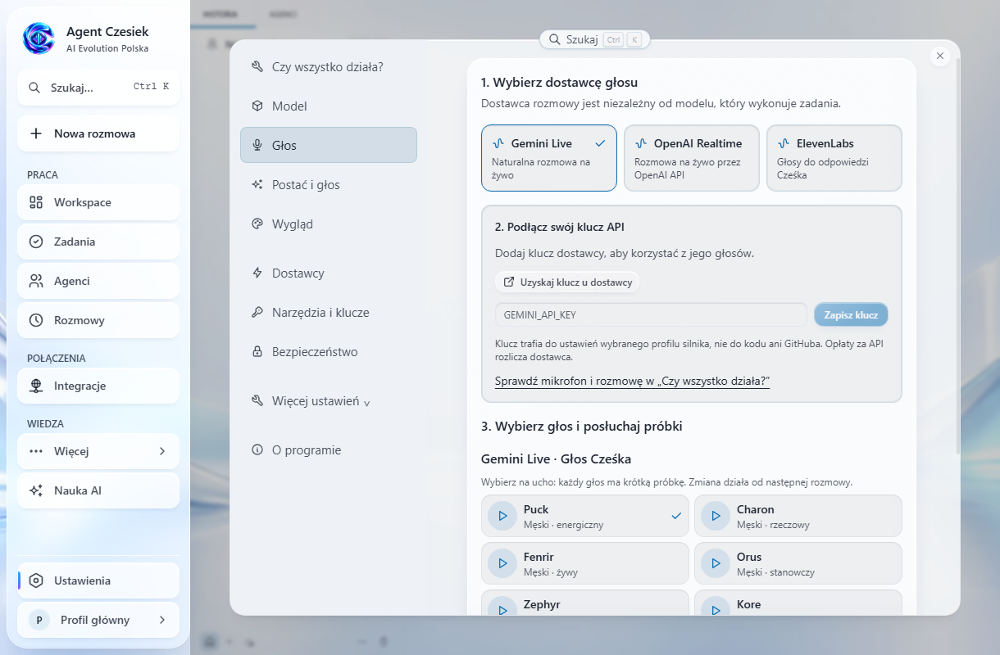

# Jak podłączyć głos Cześka

Otwórz **Ustawienia → Głos**. Ten ekran zawiera wybór dostawcy, zapis klucza i próbki głosów. Ustawienia dotyczą profilu wybranego w ustawieniach aplikacji.

1. **Wybierz dostawcę.** Gemini Live i OpenAI Realtime obsługują rozmowę na żywo. ElevenLabs dostarcza głosy do odczytywania odpowiedzi Cześka; rozpoznawanie mowy działa wtedy w trybie klasycznym.
2. **Wklej swój klucz API i kliknij „Zapisz klucz”.** Przycisk „Uzyskaj klucz u dostawcy” otwiera właściwy panel API w przeglądarce systemowej. Klucz zostaje w ustawieniach wybranego profilu silnika. Przy lokalnym silniku jest zapisany na Twoim komputerze; przy połączeniu zdalnym — na serwerze tego silnika. Pole jest maskowane i zostaje wyczyszczone po udanym zapisie. Komunikat „Klucz zapisany” potwierdza zapis, a nie ważność klucza u dostawcy.
3. **Wybierz głos i posłuchaj próbki.** Gemini i OpenAI mają osobne katalogi. Lista ElevenLabs jest pobierana z Twojego konta i odświeża się po zapisaniu klucza. Potrzebne są uprawnienia klucza do listy głosów i syntezy mowy.
4. **Zacznij nową rozmowę.** Zmiana dostawcy nie przełącza trwającego połączenia głosowego. W panelu „Czy wszystko działa?” sprawdź mikrofon, głośnik i rozmowę. Dla ElevenLabs rozpoznawanie mowy można skonfigurować w „Więcej ustawień głosu”.

## Jaki klucz jest potrzebny?

| Dostawca        | Klucz                                                          | Sposób działania                                          |
| --------------- | -------------------------------------------------------------- | --------------------------------------------------------- |
| Gemini Live     | `GEMINI_API_KEY` (również istniejący `GOOGLE_API_KEY`)         | Rozmowa Live z Gemini                                     |
| OpenAI Realtime | `VOICE_TOOLS_OPENAI_KEY` (również istniejący `OPENAI_API_KEY`) | Rozmowa Live z OpenAI                                     |
| ElevenLabs      | `ELEVENLABS_API_KEY`                                           | Synteza odpowiedzi Cześka, z katalogiem i próbkami głosów |

**Subskrypcja ChatGPT nie zastępuje OpenAI API do rozmowy Realtime.** Możesz podłączyć logowanie ChatGPT do wykonywania zadań w sekcji „Dostawcy”, a osobno używać Gemini lub OpenAI API do głosu. Korzystanie z API jest rozliczane przez danego dostawcę.

Model do wykonywania zadań i współpracownicy pozostają niezależni od wybranego głosu. Nie trzeba podłączać osobnego agenta ElevenLabs Conversational AI ani podawać Agent ID.
